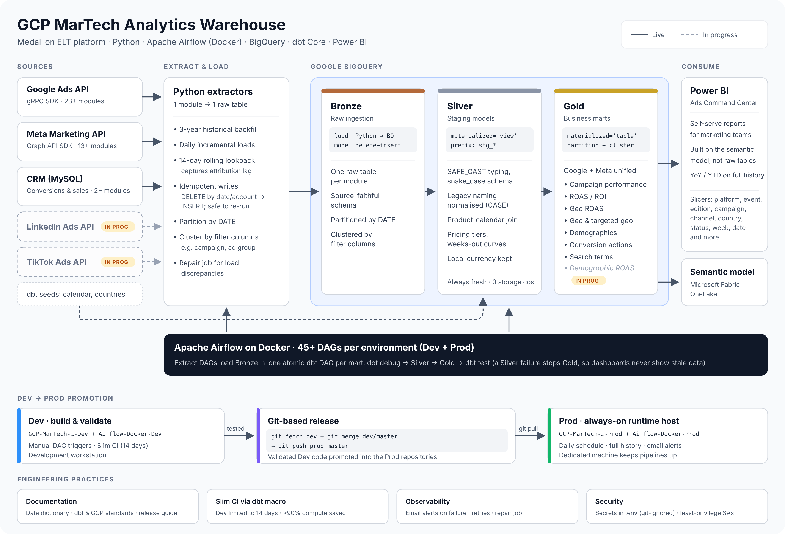

# 🧠 GCP MarTech Analytics Warehouse

**Data Engineering & Marketing Analytics Automation Pipeline**



This repository contains the codebase for the **Google Cloud Platform (GCP) Marketing Technology Analytics Warehouse**. It is designed to automate the extraction, transformation, and loading **(ETL/ELT)** of multi-channel marketing data into **BigQuery** for advanced analytics, reporting, and budget optimization.

---

## 📦 Overview

The GCP MarTech Analytics Warehouse integrates diverse marketing data sources (including **Google Ads**, **Google Analytics 4**, **Meta Ads**, **LinkedIn Ads**, **TikTok Ads**) into a **centralized BigQuery warehouse**.

### Core Pipeline Mechanics: The Medallion Architecture

I follow a strict Bronze -> Silver -> Gold data flow to ensure data quality, lineage, and performance.

🟤 1. Bronze Layer (Raw Ingestion)

**Goal:** Ingest data from APIs with 100% fidelity. **Tech Stack:** Python (Custom Airflow Operators) -> BigQuery.

**1. Extraction:**
Raw data is extracted using custom Python scripts via official **APIs** for each platform. The data is ingested directly into a **Bronze (Raw)** dataset in BigQuery.

- **Idempotency:** I enforce strict idempotency using DELETE (based on Date/Account) before INSERT. This allows any DAG to be re-run safely without creating duplicate records.

**2. Loading Strategy:**
The Google Ads pipeline comprises **23 distinct extraction modules** producing 23 raw tables, Meta Ads pipeline comprises **13 distinct extraction modules** producing 13 raw tables and Other (CRM related) extraction comprises **2 distinct extraction modules**. The load process implements advanced data engineering logic:

- **Historical Backfill:** Captures the past 3 years of data to enable Year-over-Year (YoY) and Year-to-Date (YTD) performance comparison.


- **Incremental Loading:** Efficiently appends new daily records to the historical dataset.


- **Rolling Lookback Window (CDC):** Implements a 14-day lookback window to capture **Change Data (CDC)** and **Attribution Lag** (e.g., conversions attributed days after the ad click).


- **Partitioning:** Handled within the Python load step; tables are partitioned by `DATE` for query optimization.


- **Clustering:** Tables utilize clustered columns (e.g., `Campaign ID`, `Ad Group ID`, `Important Columns`) to reduce query costs and latency.

---

**🥈 2. Silver Layer (Staging & Normalization)**

**Goal:** Clean, standardize, and prepare data for joining. **Tech Stack:** dbt Core (View Materialization).

**Materialization Strategy:** Configured as view.

- Why? Views act as a "pass-through" window. They provide **Instant Change Data Capture (CDC)**—as soon as raw data lands in Bronze, the Silver view reflects it immediately.


- Cost Benefit: Since Views store no physical data, this layer incurs $0 Storage Cost.

**Transformation Logics:**

- **Schema Standardization:** Enforces strict data typing across all tables (e.g., SAFE_CAST to INT64/FLOAT64) and normalizes column names to snake_case, ensuring consistent schema definitions regardless of the source platform.


- **Smart Parsing & Normalization:** Cleans inconsistent dimensional data using CASE logic to handle legacy naming conventions, ensuring historical data aligns with current reporting structures.


- **Global Product Mapping:** Automatically joins ad data with the `Global Products Calendar` to map generic campaigns to specific product instances (e.g., mapping "LEAP Riyadh" to "LEAP Riyadh 2025", mapping "AVIATION WEEK" to "AVIATION WEEK 2025", mapping "WHX Dubai" to "WHX Dubai 2027").


- **Dynamic Pricing tiers:** Calculates "Cut-Off Rates" (e.g., *SEB*, *EB*, *Advance*, *FP*, *Standard*, *Onsite*) based on the transaction date relative to the product calendar.


- **Countdown Logic:** Computes `Weeks Out` metrics (e.g., "Week 10", "Week 0") to enable time-relative performance curves for comparing products performance year-over-year.


- **Local Currency Preservation:** Maintains original currency and cost metrics as reported by the source API (GBP, EUR, USD, etc.) to ensure 100% financial alignment with the platform UI.

**Cost Saving (Slim CI):** In the Development Environment, I use Jinja Macros () to limit processing to the last 14 days. This reduces cloud compute costs by >90% during testing.


- Full Historical Integrity (Prod): While Dev is optimized for speed, the Production pipeline automatically bypasses these filters to process the full historical dataset, ensuring accurate Year-over-Year (YoY) and Year-to-Date (YTD) trend analysis.

---

**🥇 3. Gold Layer (Marts & Business Intelligence)**

**Goal:** Aggregated, business-ready tables for Dashboarding. **Tech Stack:** dbt Core (Table Materialization).

**Materialization Strategy:** Configured as table.

- Why? Tables persist data physically. This is crucial for BI tools (Power BI) because complex UNION ALL operations and Joins are computed once during the morning run, protecting the dashboard from slow query times.

**Logic:**

- **Consolidation:** Stacks Google and Meta data into a single ads_performance master table.

- **Optimization:** Tables are Partitioned (by Date) and Clustered (by Platform/Product/Important Columns) to ensure high-speed filtering.

---

### Orchestration Architecture

The pipeline is orchestrated using **Apache Airflow** deployed via two distinct **Docker containers**:

**Coupling Strategy: Tightly Coupled DAGs**

I deliberately group the Transformation phase (Silver -> Gold) into a single atomic DAG.

- **Why Tightly Coupled?** To guarantee data integrity.


- **The Risk of Decoupling:** If I separated Silver and Gold into different DAGs, a failure in Silver could lead to Gold running on stale data.

**The Solution:** By coupling them, we ensure an Atomic Transaction: either the entire pipeline succeeds, or it stops at the error, preventing "silent failures" in the dashboard.

**Deployment Model**

- **Airflow-Dev:** Contains 45 DAGs using **PostgreSQL**. No scheduling enabled. Used strictly for development testing, unit validation, and "Slim CI" runs.

- **Airflow-Prod:** Contains 45 DAGs using **PostgreSQL**. Daily scheduling is active. Used for deploying and orchestrating core ETL processes on full data history.

---

**📚 Data Dictionary (SharePoint)**

The single source of truth for all metric definitions, schema lineage, and column descriptions is maintained in the MarTech Data Dictionary on SharePoint. This file serves as the blueprint for our BigQuery schema.

- **File Name:** MarTech Dictionary.xlsx


- **Content:** Detailed data points for Google Ads, Meta Ads, LinkedIn Ads, and TikTok Ads (separated by sheets).

**Key References:**

- Marketing Bronze Sheet, 
- Marketing Silver Sheet, 
- Marketing Gold Sheet.

This specific sheet defines the exact schema for the **Bronze (Raw)** layer in BigQuery. It is used to validate Python extraction scripts and dbt source definitions (`src_marketing.yml`).

**Schema Definition Columns:**

**Marketing Bronze Sheet:**

- `dataset`: The target BigQuery dataset.

- `table_no`: Unique identifier for the table in the pipeline.

- `table_name`: Technical name of the table.

- `row`: Row number reference.

- `column_name`: The exact column name as it appears in BigQuery.

**Marketing Silver Sheet:**

- `env`: The target execution environment (e.g., `dev`, `prod`).

- `layer`: The pipeline stage identifier (e.g., `silver`).

- `logic`: The type of operation being performed (e.g., `transform`).

- `materialization`: The storage strategy used in BigQuery (e.g., `view`).

- `script_name`: The technical name of the dbt model or transformation script (e.g., `stg_google_ads_performance`).

- `dataset_name`: The target BigQuery dataset where the view is created (e.g., `marketing_prod_silver`).

- `column_no`: The ordinal position of the column in the final view.

- `column_name`: The standardized, snake_case column name as it appears in the Silver view.

**Marketing Gold Sheet:**

- `env`: The target execution environment (e.g., `dev`, `prod`).

- `layer`: The pipeline stage identifier (e.g., `gold`).

- `logic`: The business logic applied to the table (e.g., `business_ready`).

- `materialization`: The storage strategy used in BigQuery (e.g., `table`).

- `script_name`: The technical name of the dbt model (e.g., `ads_campaign_performance`, `ads_conversion_action`).

- `dataset_name`: The target BigQuery dataset where the table is created (e.g., `marketing_prod_gold`).

- `column_no`: The ordinal position of the column in the final table.

- `column_name`: The exact column name as it appears in the Gold table.

---

## 🏗️ Architecture Summary

| Layer | Description                                                                                                             |
|--------|-------------------------------------------------------------------------------------------------------------------------|
| **Extract** | Pulls data from APIs (Google Ads, GA4, Meta Ads, LinkedIn Ads, TikTok Ads etc.) using official SDKs and Python scripts. |
| **Transform** | Performs cleaning, aggregation, and enrichment of raw datasets using SQL with DBT Core                                  |
| **Load** | Writes structured data into BigQuery datasets following best schema practices.                                          |
| **Orchestration** | Apache Airflow manages DAGs, task dependencies, retries, and SLAs.                                                      |
| **Secrets Management** | Environment variables securely store credentials.                                                                       |

---

## 📅 Project Roadmap & Scope

This is an active, ongoing engineering initiative.

- **✅ Phase 1 (Complete):** Google Ads Extraction & Loading (21 Tables).


- **🔄 Phase 2 (Complete):** Meta Ads (Facebook/Instagram) API Integration (12 Tables).


- **🔜 Phase 3 (Complete):** Transformation Layer using **dbt** (Data Build Tool) to create Gold/Mart datasets.


- **🧱 Phase 4 (Semantic Model):** Construction of a Unified Semantic Model ingested into **Microsoft Fabric OneLake**, establishing an enterprise-grade, single source of truth across all paid marketing channels.


- **📊 Phase 5 (Analytics Platform):** BI deployment via **Power BI** to visualize ad performance metrics such as ROAS, ROI, campaign performance, audience demographics, search term analysis, platform performance, geographic performance, and more, enabling budget pacing and optimization to improve marketing strategy and support Marketing Team and Director of Marketing in data-driven decision-making.

> **🔄 Note on Ongoing Development:** I am actively extending this architecture to ingest data from additional marketing and web analytics sources, with connectors currently being built for **LinkedIn Ads, TikTok Ads, and Google Analytics 4 (GA4)**.

---

## 📁 Folder Structure

```text
├── dags/ # Airflow DAG definitions (Dev/Prod)
├── extract/ # Source data extraction scripts (Python)
├── load/ # BigQuery load operations & schema definitions
├── repair/ # BigQuery load repair
├── transform/ # Transformation and cleaning logic
│   ├── models/staging/    # Silver Layer (Views)
│   └── models/marts/      # Gold Layer (Tables)
│   └── seeds/     # Reference Layer
├── utils/ # Helper modules (logging, config, etc.)
└── README.md # Project documentation
├── best_practices.txt / # GCP & Engineering Guidelines
├── dbt_best_practices.sh / # DBT Guidelines
├── git_devops # CI/CD and version control references
├── requirements.txt # Python dependencies
├── test.py # perform various tests
```
---

## ⚙️ Airflow & GCP Integration

- **Containerization:** Airflow runs on Docker (`Airflow-Docker-Dev` / `Airflow-Docker-Prod`)  
- **Data Warehousing:** BigQuery serves as the central repository.
- **SDK Integration:** Utilizes the official `google-ads`, `facebook-ads` Python library.  
- **Idempotency:** Incremental logic ensures data consistency without duplication.  
- **Environment Variables:** Separate .env configurations for Dev and Prod credentials.

---

## 🚀 Development & Deployment

The setup follows a strict two-environment architecture:

### 🧪 Dev Environment (`GCP-MarTech-Analytics-Warehouse-Dev`)

Used for DAG authoring, unit testing, and incremental load validation.

Run using:
```bash
docker compose run --rm airflow-init
docker compose up -d
```

Admin Access: http://localhost:8081

- Note: **Data Limit = Last 14 Days (Automatic Cost Saver via dbt macros)**, implemented for silver -> gold `dev` processes.

---

### 🏭 Production Environment (GCP-MarTech-Analytics-Warehouse-Prod)

Used for stable, scheduled data pipelines and automated reporting feeds.

Run using:
```bash
docker compose up -d
```

Admin Access: http://localhost:8080

- **Data Limit:** Full History (All Time).

- **Alerting:** SMTP Email alerts enabled for failures.

---

🔒 Security Policy

- **Secrets Management:** `.env`, `.yaml`, and `.json` files are strictly excluded via .gitignore.
- **IAM**: GCP Service Accounts utilize Least Privilege access principles.
- **Authentication:** All API connections are authenticated via secure OAuth2 flows or encrypted JSON key files
- **Audit:** Access logs are reviewed and API keys are rotated quarterly.

---

🤝 Code of Conduct

We strive to maintain high engineering standards:

- Clean, modular, and version-controlled code.
- Clear commit messages with semantic versioning.
- All DAGs must pass Dev validation before merging to Prod.
- Documentation must be updated with every major feature release.

---

🧱 Versioning

- Dev	master	v1.x.x	Active development and testing
- Prod master	v1.x.x	Stable and verified releases

---

## 📊 Analytics & Reporting (Power BI)

The final output of the pipeline is a comprehensive **Ads Marketing Command Center** dashboard deployed on the central server. This visualizes the Gold Layer data, enabling stakeholders to track & make decisions based on the granular performance metrics:

**Key Reporting Modules:**

- **💰 Financial Performance:**
Real-time tracking of **Spend, Sales, Revenue, and ROAS**.

  - *Analysis:* Year-over-Year (YoY) and Year-to-Date (YTD) growth.
  - *Dimensions:* Filter by Platform, Event, Event Edition, Campaign, Pricing Tier (`cut_off_rate`), and Sales Curve (`weeks`).


- **📈 Traffic & Engagement:**
High-level view of **Impressions, Clicks, CTR%, and CPC**.
  - *Drill-down:* Analyze efficiency across specific Channels (`channel_type`) and Campaign Strategies.


- **📍 Geo ROAS:**
Deep-dive into geographic profitability and market-specific return on ad spend.
  - *Analysis:* Identify **Top Markets by Sales and Revenue**, and track **Revenue & ROAS** trends across product instances and specific weeks.
  - *Dimensions:* Filter data dynamically by **Country, Platform, Product Instance, and Standardized Conversion Type** (e.g., Purchase, Lead, Add to Cart).


- **🌍 Geographic Insights:**
Geo-spatial analysis of market efficiency.
  - *Metrics:* Impressions vs. Engagement by location.
  - *Granularity:* Drill down by **Country, Region, and Target Type** (`geo_target_type`).


- **👥 Audience Demographics:**
Segmentation analysis to identify high-value personas.
  - *Breakdown:* Performance metrics split by **Age Group and Gender**.


- **🚀 Ongoing Development:**
  Additional analytics modules (e.g., Search Term Analysis, Attribution Modeling, etc..) are currently in the engineering roadmap.

### Dashboard Preview:


*(Note: Sensitive financial figures, legends and other numbers have been masked for data privacy).*

🧠 Author & Maintainer

Prasanna - *Senior Data Engineer & Analytics Specialist*

📧 prasanna.uthamaraj@informa.com

🌐 GitHub: PrasannaDataBus

🏁 License

- This repository and its contents are proprietary to Informa PLC / PrasannaDataBus.
- Unauthorized redistribution, public sharing of API credentials, business logic, or proprietary connectors is strictly prohibited.
